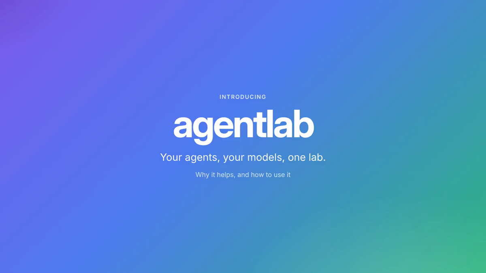

# agentlab

A local, zero-dependency lab for AI agents (Python 3.9+): build agents on any model, give them projects with their own space, let them work while you watch (or sleep), and see exactly what they did and what it cost. It started as four tools for trustworthy agents, which are still here:

| Tool | What it does |
|---|---|
| **Flight Recorder** (`recorder`) | Log every agent step to JSONL, replay it as a timeline, fork a run from any step. |
| **Prompt Regression Lab** (`regress`) | Save baseline outputs, then diff after a prompt/model change. Fuzzy drift detection plus hard constraints. Exit code 1 for CI. |
| **Permission Sandbox Designer** (`sandbox`) | Write plain rules, get a least-privilege Claude Code `settings.json` block, and see which attack attempts would slip through. |
| **Hallucination Tripwires** (`tripwires`) | Plant seed-derived canary facts in documents, then audit answers for recall, contradiction and invention. |

## Quick start

```
pip install -e .
agentlab connect                      # sets up every agent it finds (or name one: claude-code | kimi | openclaw)
agentlab connect --policy rules.txt   # ...and enforce your sandbox rules
agentlab serve                        # dashboard at http://127.0.0.1:8765
agentlab status                       # what is connected
```

Use your agent as normal. Every prompt, tool call and edit is recorded under `.agentlab/runs/`, and tool calls that break your rules are blocked (the hook exits with code 2 and tells the agent why). Secrets are redacted before anything is written. `agentlab disconnect <agent>` removes what `connect` added.

agentlab only records in projects you have connected (those with a `.agentlab/` folder), even when an agent's hook is installed user-wide.

## Watch the tour

[](docs/media/agentlab-presentation.mp4)

`docs/media/agentlab-presentation.mp4` — 1 minute 47 seconds on what agentlab gives you and how to use it (real screens, no narration).

## Agent platform (`agentlab serve`, then open the dashboard)

| Area | What you get |
|---|---|
| **Agents on any model** | Anthropic, OpenAI, OpenRouter, Groq, Mistral, Gemini, DeepSeek, xAI, Hugging Face, Cloudflare Workers AI, Ollama, LM Studio, llama.cpp, vLLM, OpenClaw, any OpenAI-compatible URL, any HTTP API, any CLI agent, or **your own GGUF weights** (run locally on CPU or GPU, threads configurable). Models without function calling use a text tool protocol. Pick a preset role (manager, developer, reviewer, ...) or none. |
| **Control** | Custom instructions, answer style, language, max tokens per answer, token budgets per job and per day. Modes: *ask before every action*, *ask only for risky actions*, *full auto*, plus allow/ask/deny per action type. Dangerous commands are blocked or need confirmation even in full auto. |
| **Projects** | A private workspace per project with a space quota, file browser, uploads, environment variables, a Python venv, an offline mode, GitHub and Hugging Face import, and its own AI (model + dataset + **Train** button). |
| **Jobs** | Background agent jobs with progress bars and metrics (tokens, cost, calls, files, approvals), approvals in the UI, a **step-through debugger** (pause before each model call or tool call, edit or skip a tool call), parallel batches (compare agents on one task, or fan out many) with a resizable parallel limit, schedules (cron or every N minutes). |
| **Learning** | Memory, a diary written after each job, improvement proposals from lessons and your 👍/👎, **auto-improvement gated by evaluation cases** (accepted only when the score rises with no regressions), rollback, and **dream mode** (reflects during a sleep window, no tools). |
| **Compare** | Give two or more of your models the same question and get the answers side by side with real numbers: tokens in and out, cost, cost per 1k output tokens, median latency and its spread across repeated runs, tokens per second, answer length and how much the answers overlap. Optionally ask a judge model to rank them, labelled as an opinion rather than a measurement. |
| **Code pad** | Syntax highlighting, smart indent, bracket and quote pairing, comment toggle, move and duplicate lines, find and replace, a status bar with an estimated token count, live correction suggestions as you type with one-click fixes, run JavaScript in a sandbox or Python/shell in an isolated environment, and a one-click review by one of your agents. |
| **Talk** | Playground: chat with any model or agent, compare models on the same prompt, attach files, per-answer tokens/speed/cost, and **widgets** (charts, tables, forms, small apps in a sandboxed frame). Rooms: several agents talk and cooperate on a goal, with a manager. |
| **Models** | Models dashboard (usage, p50/p95 latency, cost, test results), a test battery that recommends the tool mode, model listing for OpenAI/Anthropic/compatible servers, accounts for GitHub, Hugging Face, OpenAI and Anthropic, embedding models, knowledge bases with a robots.txt-respecting web scraper. |
| **Training** | Built-in text classifier (trains on CPU in seconds) and LoRA fine-tuning (script run in the project's venv), live loss curves, **overfit protection** (validation split, early stopping, best epoch kept, warnings), and model editing (teach a correction, rename/drop labels, undo). |
| **Build & ship** | 14 templates (websites, games, model projects, infrastructure), "build with AI", doc builder (README, API reference from OpenAPI or code, guide, changelog), compatibility and optimisation checks, packages with installers, one-click deploy to localhost or Cloudflare Pages/Workers, a **built-in terminal**, your own /commands, skills and plugins. |
| **Privacy & insights** | Password-protected private agents, keys stored by name (never in logs), usage by agent/model/project/kind, notifications, AI suggestions, an interactive tutorial, 6 UI languages and personalisation (themes, accents, gradients). |

Everything is reachable over the local HTTP API too (`/api/lab/...`, described in `/api/openapi.json`; client libraries are generated on the API page).

Honest limits: private agents protect the API and UI, not the files on disk (they are not encrypted). The terminal is your own shell, not a sandbox. LoRA training needs torch, transformers, peft and datasets installed in the project's Python environment and was tested here with a stand-in process, not a real GPU run. Cloudflare deploys need Node.js and were tested with a stand-in for wrangler. New platform screens are in English; navigation labels are translated.

## Supported agents

| Agent | Recording and enforcement | MCP tools | What `connect` does |
|---|---|---|---|
| **Claude Code** | Hooks (`PreToolUse`, `PostToolUse`, ...) | `.mcp.json` | Merges hooks into `.claude/settings.json` |
| **Kimi Code CLI** | Hooks, same events and exit-code-2 blocking ([docs](https://moonshotai.github.io/kimi-code/en/customization/hooks.html)) | `.kimi-code/mcp.json` ([docs](https://moonshotai.github.io/kimi-code/en/customization/mcp.html)) | Appends a marked `[[hooks]]` block to `~/.kimi-code/config.toml` (your file is never rewritten) |
| **OpenClaw** | Plugin with a `before_tool_call` hook that can block ([docs](https://docs.openclaw.ai/plugins/hooks/tool-policy)) | `mcp.servers` in `~/.openclaw/openclaw.json` ([docs](https://docs.openclaw.ai/gateway/config-extensions)) | Generates a plugin in `.agentlab/openclaw-plugin/` and runs `openclaw plugins install` if the CLI is present; prints the optional MCP snippet |

Any other MCP-capable agent can use `agentlab mcp --print-config` (advisory only, see below).

What is verified and what is not:

- Tool names and parameters differ per agent (`file_path` vs `path`, `FetchURL`, `exec` ...). `adapters.py` maps them to one shape, and a known file, shell or web tool whose path, command or URL can't be recognised is **blocked, not guessed**.
- The Kimi and OpenClaw integrations follow their published docs and are covered by tests that feed their payload shapes to the hook and run the generated OpenClaw plugin in Node against a stub of its SDK. They have **not been run inside the real Kimi Code or OpenClaw apps**. Two details are assumed: Kimi's stdin field for the tool name (we accept `tool_name`, `toolName` or `tool`) and OpenClaw's `exec` parameter name (`command`).
- OpenClaw's plugin SDK is documented as experimental and needs a recent OpenClaw (the plugin declares `openclaw >= 2026.5.17`).
- If agentlab can't start, hooks fail open so your agent keeps working. The OpenClaw plugin spawns `agentlab hook` per tool call, which adds a short delay.

## Dashboard

`agentlab serve` opens a minimal, Apple-style dashboard with a sidebar:

| Section | What it does |
|---|---|
| **Dashboard** | Totals for the last 24 hours, a **health status per agent** with plain reasons, an hourly activity chart, top tools and recent sessions. Refreshes itself. |
| **Activity** | Replay any recorded run step by step and fork it from any point. |
| **Tasks** | Run commands in a **dedicated environment**, review the changes, apply only what you want. |
| **Pad** | A code scratchpad saved with your project. JavaScript runs in an isolated browser sandbox; Python and shell can run in a dedicated environment. |
| **Sandbox** | Write rules in plain language, test them against 12 attacks, enforce them through agent hooks. |
| **Checks** | Regression tests for prompts, and tripwires that catch hallucinations. |
| **Connectors** | Connect agents, and send **webhooks** (Slack, Discord or any service) when a call is blocked, a task finishes or something errors. |
| **API** | Generate a client (Python, JavaScript, TypeScript, curl), manage optional API keys, browse every endpoint (OpenAPI at `/api/openapi.json`). |

First run asks for your language (English, Español, Français, Deutsch, 简体中文, 日本語). The gear icon holds appearance, accent colour, text size and code preferences. To add a language, add one object to `agentlab/ui/i18n.json`; a test checks every key exists.

### Agent health

Health is computed from what agents actually did, not from a ping:

- **Unhealthy**: errors are 10% or more of an agent's steps.
- **Needs attention**: some errors, 30% or more of tool calls blocked by your policy (the agent keeps fighting your rules), a session stuck mid-task for over 5 minutes, or `agentlab hook` failing (hooks fail open, so failures are logged to `.agentlab/hook-errors.log` and surfaced here).
- **Idle / Not connected**: no activity in 24 hours, or the agent was never connected.

Also available as `agentlab insights` and `GET /api/insights`.

### Dedicated environments (Tasks)

```
agentlab task run --pass-env ANTHROPIC_API_KEY --network 'claude -p "fix the failing test"'
agentlab task run 'pytest -q'                 # network blocked by default
agentlab task show <id>                       # diff of what it changed
agentlab task apply <id>                      # copy the reviewed changes into your project
```

Each task works in its own disposable copy of the project under `.agentlab/tasks/<id>/`:

- **Your project is not touched** until you apply. Apply refuses paths under `.agentlab/`, `.claude/`, `.kimi-code/`, `.git/`, `.mcp.json` and `.github/workflows/`, and any file you edited since the task began.
- **Scrubbed environment**: only `PATH`, `LANG`, `TERM`, `TZ` plus variables you list with `--pass-env`; its own `HOME`; secret-looking files (`.env*`, `*.pem`, `*.key`, `id_rsa*`, `.netrc` ...) are never copied in.
- **Network blocked by default** using `unshare`. If this machine can't do that, the task refuses to start unless you allow the network or use `--docker`.
- **Limits**: wall-clock timeout, CPU limit, no core dumps, and the whole process group is killed on timeout or cancel.
- **Docker backend** (`--docker`): `--network none` unless allowed, 2 GB memory, 2 CPUs, 512 processes, runs as your user. It is only built and unit-tested here, not run against a Docker daemon.
- **Agents stay governed**: hooks inside the copy record to your main `.agentlab/` and enforce its policy. (Not available in the Docker backend, where the agentlab CLI isn't installed.)

Honest limits: this protects your files from accidents and keeps secrets and network out of reach by default. It is **not a security boundary against hostile code**; a local task shares your kernel and user. Use the Docker backend or a VM for untrusted code. Symlinks are never copied or applied.

Running commands is the point of this feature, so the dashboard can run commands on your machine. It listens on `127.0.0.1` only, rejects other hosts and non-JSON requests, and creating an API key makes every other client authenticate. The dashboard session itself is trusted.

### Webhooks

Add them under **Connectors**. Each delivery is JSON with `text` (Slack) and `content` (Discord), an `X-AgentLab-Event` header, and, if you set a secret, an `X-AgentLab-Signature: sha256=<hmac>` header. Secrets are stored in `.agentlab/connectors.json` (mode 600) and never returned by the API. Webhook URLs are called from your machine, so only add endpoints you trust.

### Other dashboard details

```
agentlab apigen python > agentlab_client.py   # same generator from the command line
agentlab key create "ci"                       # keys are optional; shown once, stored hashed
```

Once any key exists, API calls need `Authorization: Bearer <key>` (the dashboard is exempt). Keys identify clients; they don't protect against other programs running as you on the same machine.

## MCP server (any MCP-capable agent)

```
agentlab mcp --print-config          # mcpServers JSON to paste into your agent's MCP settings
agentlab connect claude-code                # also writes .mcp.json (add --no-mcp to skip)
```

Tools: `check_policy` (ask before acting), `record_note` (log a step), `plant_canaries`, `audit_answer`. MCP is cooperative: the agent decides to call these, so it can record and advise but not enforce. Use the hook or the upcoming proxy for enforcement.

## Other commands

```
agentlab replay runs/a.jsonl --upto 2
agentlab fork runs/a.jsonl 2 runs/b.jsonl
agentlab regress baseline.json candidate.json --threshold 0.8
agentlab sandbox rules.txt          # attack simulation
agentlab sandbox rules.txt --json   # settings.json permissions
agentlab tripwire doc.txt --seed my-secret -n 3
```

```python
from agentlab import Recorder
with Recorder("runs/a.jsonl") as rec:
    rec.log("prompt", "Fix the bug")
    rec.log("tool_call", "pytest -q", tool="bash")
```

## HTTP API

All routes are JSON, on localhost only. POST bodies must use `Content-Type: application/json`.

| Route | Purpose |
|---|---|
| `GET /api/runs`, `GET /api/runs/<id>` | list runs, read one |
| `POST /api/runs/<id>/fork` `{step}` | fork from a step |
| `POST /api/events` `{run, kind, content, tool?}` | ingest an event from any adapter |
| `GET /api/agents`, `GET /api/insights` | connection status; agent health and activity |
| `GET/POST /api/tasks`, `GET /api/tasks/<id>`, `.../cancel`, `.../changes`, `.../apply`, `.../discard`, `GET /api/isolation` | dedicated environments |
| `GET/POST /api/connectors`, `POST /api/connectors/test` | webhooks |
| `GET/POST /api/policy` | read or save the project policy |
| `GET/POST /api/pads`, `GET /api/pads/<id>`, `POST /api/pads/<id>/delete` | code pads |
| `GET/POST /api/keys`, `POST /api/keys/<id>/revoke` | API keys |
| `POST /api/generate` `{language, base_url}` | generate a client; `GET /api/openapi.json` for the spec |
| `POST /api/policy/simulate`, `/check`, `/settings` | `{rules}` (plus `action`, `target` for check) |
| `POST /api/regress` | `{baseline, candidate, threshold}` |
| `POST /api/tripwires/plant`, `/audit` | `{seed, n, document}` or `{seed, n, answer}` |

Sandbox rules, one per line: `allow read src/**`, `allow write src/ and tests/`, `allow run pytest, git status`, `allow network api.github.com`, `never read .env`. Anything not allowed is denied; explicit `never` rules always win.

## Limits

Agent jobs and the terminal run commands as your user; isolation is a separate working folder, a scrubbed environment and (where the machine allows `unshare`) no network, not a container. Rule parsing is a small fixed grammar, not an LLM. The sandbox checks what a tool call names, so an allowed command can still read files its name doesn't reveal. Redaction and tripwire audits are heuristics. See `docs/PLAN.md` for the roadmap and known limits.

## Tests

```
python -m unittest discover -s tests
```
